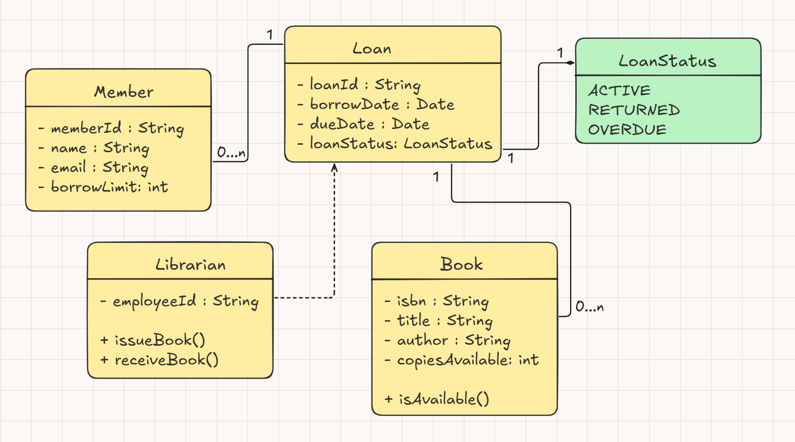

# A Mini Digital Library System

---

## System Requirements

Designed a **Class Diagram** for a simplified library management system by the following rules:

---

### Entities & Attributes
1. **`Book`**: Has `isbn` (String), `title` (String), `author` (String), `copiesAvailable` (int), and a method `isAvailable()`.
2. **`Member`**: Has `memberId` (String), `name` (String), `email` (String), and `borrowLimit` (int).
3. **`Librarian`**: Has `employeeId` (String) and can `issueBook()` and `receiveBook()`.
4. **`Loan`**: Tracks the transaction with `loanId` (String), `borrowDate` (Date), `dueDate` (Date), and `status` (Enum: ACTIVE, RETURNED, OVERDUE).

### Relationships & Multiplicity
1. A **`Member`** can have multiple active **`Loan`** records at a time (e.g., 0 to 5), but a **`Loan`** belongs to exactly one **`Member`**.
2. A **`Book`** can be associated with multiple **`Loan`** records over time, but a specific **`Loan`** instance references one **`Book`**.
3. A **`Librarian`** manages and creates **`Loan`** transactions.

---

### Final Output

